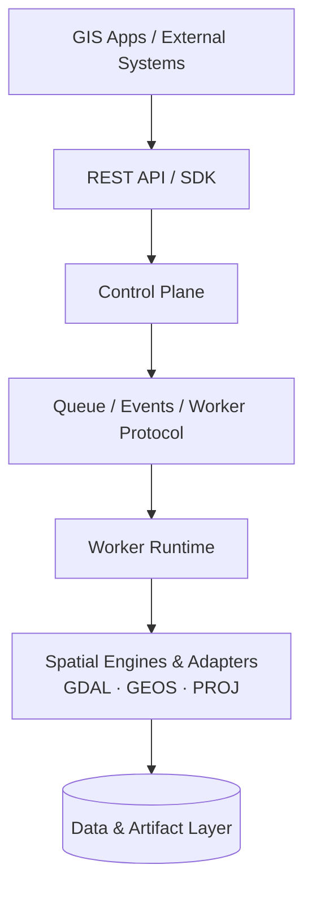
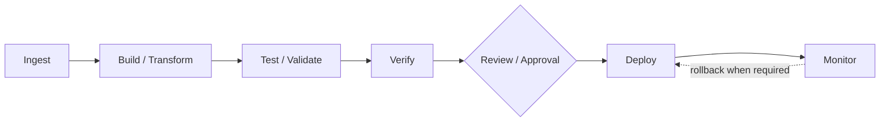

<div align="center">

# 🛤️ SpatioRail

**From Spatial Data to Production, Reliably.**

A spatial-native workflow orchestration framework for geospatial processing,
distributed workers, data validation, versioning, and safe production releases.

[](#project-status)
[](LICENSE)
[](#technology-direction)
[](CONTRIBUTING.md)

[Why](#why-spatiorail) ·
[Preview](#preview) ·
[Concepts](#core-concepts) ·
[Architecture](#architecture) ·
[Roadmap](#roadmap) ·
[Contributing](#contributing)

</div>

---

## Project status

> [!WARNING]
> SpatioRail is in **early-stage design and development**. The capabilities
> described here represent the project direction and roadmap. They are **not**
> a claim that every feature is already implemented.

## Why SpatioRail?

Geospatial workflows span many tools, formats, databases, and applications.
Running them reliably takes more than a collection of isolated GIS scripts.

SpatioRail aims to be the orchestration layer that lets you:

- 🔗 **Define pipelines as DAGs** with explicit, dependency-aware steps.
- ⚙️ **Run jobs on workers** that can be written in different languages and run on different machines.
- 🗺️ **Plug in any spatial engine or data source** without coupling to one GIS application.
- 🌊 **Process large datasets** with streaming, chunking, and bounded memory.
- ✅ **Validate before you promote.** A successful run is not an approved release.
- 🕰️ **Track executions, artifacts, lineage, and versions**, and roll back when needed.

SpatioRail is **not** a replacement for GIS desktop applications or for
established libraries such as GDAL, GEOS, and PROJ. It is infrastructure for
dependable geospatial data pipelines.

## Preview

> [!NOTE]
> Illustrative only. The API below shows the intended direction and is **not
> implemented yet**. Names and signatures will change.

```python
from spatiorail import Pipeline

pipeline = Pipeline("parcels-update")

@pipeline.step()
def ingest():
    """Read source data and register it as an artifact."""

@pipeline.step(depends_on=[ingest])
def transform():
    """Reproject, clean, and build the output dataset."""

@pipeline.step(depends_on=[transform])
def validate():
    """Run spatial quality gates (geometry validity, CRS, schema, ...)."""

@pipeline.step(depends_on=[validate], gate="approval")
def release():
    """Promote the approved artifact to production."""
```

## Core concepts

SpatioRail deliberately separates **execution**, **artifact**, and **release**.
A successful execution never overwrites production data on its own.

| Concept       | Meaning                                              | Example               |
| ------------- | ---------------------------------------------------- | --------------------- |
| **Pipeline**  | The workflow definition                              | `parcels-update`      |
| **Execution** | One attempt to run that workflow                     | run #42               |
| **Artifact**  | An output produced by processing                     | `parcels_v42.gpkg`    |
| **Release**   | An artifact that passed required checks and was promoted | `parcels v1.3`    |

Rolling back changes which release is live. It never discards execution history.

## Architecture



<details>
<summary><b>Control plane (planned responsibilities)</b></summary>

- API Gateway
- Pipeline Registry
- Scheduler
- Job Queue
- Execution Manager
- Version Manager
- Approval and Policy
- Monitoring and Audit

</details>

<details>
<summary><b>Worker runtime (planned worker types)</b></summary>

- Native spatial workers
- Python workers
- External workers in languages such as Go, Rust, Java, or Node.js
- Container-based workers

External workers communicate through a **stable protocol**, not a C++ ABI.

</details>

## Pipeline lifecycle



## Large-data strategy

SpatioRail targets workloads with large vector and raster datasets:

- Streaming and chunk-based processing with bounded memory
- Spatial partitioning where appropriate
- Controlled parallelism and backpressure between stages
- Passing **artifact references and metadata** between tasks, never whole datasets through queues
- Immutable artifacts where practical
- Incremental processing and caching where benchmarks show a benefit

Optimization is benchmark-driven. The project does not aim to reimplement
GDAL, GEOS, or PROJ without a demonstrated need.

## Design principles

| Principle              | In practice                                                                 |
| ---------------------- | --------------------------------------------------------------------------- |
| **Application-agnostic** | Integrates with WebGIS, QGIS, ArcGIS, geoportals, and custom apps via APIs, SDKs, and worker protocols |
| **Spatial-native**     | Geospatial data, operations, validation, and lifecycle are first-class      |
| **Engine-agnostic**    | Orchestration is not coupled to a single spatial engine                     |
| **Worker-based**       | Workers run independently and, over time, across multiple machines          |
| **Scalable by design** | Streaming, chunking, partitioning, and backpressure over in-memory loading  |
| **Reproducible**       | Execution metadata, artifact references, versions, and lineage are retained |
| **Safe by default**    | A successful execution is distinct from an approved production release      |

<details>
<summary><b>Guiding decisions</b></summary>

- Do not pass entire datasets through the job queue.
- Do not require every worker to use the same programming language.
- Do not couple external workers to a C++ ABI.
- Do not equate execution success with production release.
- Do not discard execution history when rolling back.
- Do not build every planned component before validating the core architecture.
- Benchmark before introducing custom native optimizations.

</details>

## Technology direction

These are architectural directions, not immutable requirements. They may be
refined as the project is prototyped and benchmarked.

| Area                         | Initial direction                                      |
| ---------------------------- | ------------------------------------------------------ |
| Control plane & orchestration | Python                                                |
| Spatial processing           | GDAL, GEOS, PROJ                                       |
| Native extensions            | C/C++ when justified                                   |
| Metadata & initial queue     | PostgreSQL                                             |
| API                          | REST / HTTP                                            |
| Worker communication         | HTTP-based protocol first; gRPC / Protobuf may be evaluated |
| Artifact storage             | Local filesystem first; S3-compatible storage later    |
| Data interchange             | Apache Arrow where useful                              |
| SDK                          | Python first; TypeScript later                         |

## Roadmap

Development is intentionally incremental.

- [ ] **Phase 1: Core foundation**: job model, execution lifecycle, PostgreSQL-backed queue, basic worker, REST API, status, logs, retry
- [ ] **Phase 2: Spatial runtime**: GDAL/GEOS/PROJ integration, initial vector and raster operators, streaming and chunking, validation
- [ ] **Phase 3: Pipeline system**: DAG execution, dependency resolution, timeout, cancellation, scheduling, initial Python SDK
- [ ] **Phase 4: Data lifecycle**: artifact registry, dataset snapshots, spatial diff, quality gates, approval, release, rollback
- [ ] **Phase 5: Ecosystem**: external worker protocol, more SDKs, plugin/operator registry, service adapters, dashboard, distributed workers

## How is this different?

General-purpose orchestrators such as Airflow, Dagster, and Prefect are mature
and excellent at scheduling and running tasks. SpatioRail does not aim to
replace them for general workloads. Its focus is the geospatial case:

- Spatial data, validation, and quality gates as first-class concepts
- A built-in separation between *execution*, *artifact*, and *release*
- Approval-gated promotion and rollback of spatial datasets
- Worker and adapter protocols designed around spatial engines and GIS applications

## Getting started

Coming soon. The project is still in design and prototyping.

## Who is it for?

- GIS and WebGIS platform teams
- Spatial data engineering teams
- Geoportal and geospatial service operators
- Organizations running recurring geospatial ETL and data-quality workflows
- Developers integrating spatial processing into larger applications

## Contributing

Contributions, ideas, and feedback are welcome. Because the project is at an
early stage, please open an issue to discuss significant changes before
submitting a pull request. See [CONTRIBUTING.md](CONTRIBUTING.md) for details.

## License

Licensed under the [Apache License 2.0](LICENSE).

---

<div align="center">

*SpatioRail is infrastructure for dependable geospatial data pipelines, not a replacement for GIS desktop applications or established spatial libraries.*

</div>
